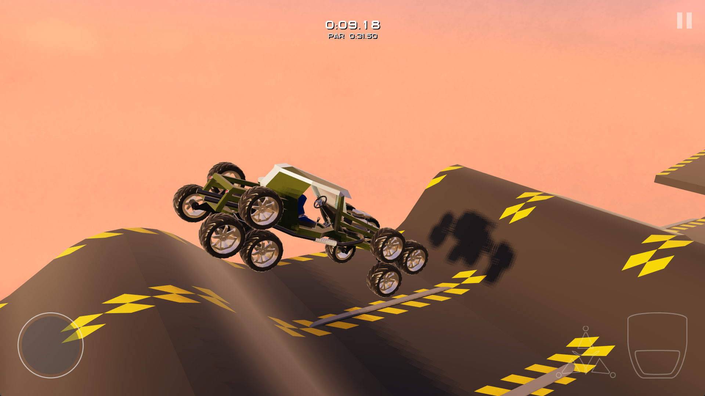

# Triple Wheel 3D (TW3D)



An obstacle course driving game with 3D graphics and 2D physics: a car with
rotating axles has to get through the track by rotating and locking its axles.
The project was created in 2016 as an appendix to a bachelor's thesis (sample
game + level editor) and was migrated to current tools in 2026. It is built on
[MonoGame](https://monogame.net/) and
[Aether.Physics2D](https://github.com/nkast/Aether.Physics2D), and runs on Windows
and Android phones.

## Getting started

With the [.NET SDK 10](https://dotnet.microsoft.com/download) or newer:

```sh
dotnet run --project src/TW3D.Game          # the game
dotnet run --project src/TW3D.LevelEditor   # the level editor (Windows only)
```

| Key | Action |
|---|---|
| → / ← | Accelerate / reverse |
| ↑ / ↓ | Rotate the axles |
| Space | Brake |
| Left Ctrl | Lock the axle rotation |
| Esc | Pause |

The on-screen controls, a gamepad and touch work too.

## Documentation

- [Building and running](docs/building.md): requirements, development arguments, Android
- [Playing](docs/playing.md): menus, garage, options, controls, scoring, development keys
- [Levels](docs/levels.md): the level editor and the level format
- [Game content](docs/content.md): models, the garage, the catalog, collision shapes
- [Architecture](docs/architecture.md): repository and code structure, frame timing, lighting
- [History and roadmap](docs/history.md)

## License

[MIT](LICENSE), © 2014–2026 Antonín Pražský: the code, the game content
(`content/`, except PromptFont below) and the documentation.

The physics engine **Aether.Physics2D** is used as a NuGet package and is licensed
under the Microsoft Public License (Ms-PL). It is based on Farseer Physics
(© Ian Qvist) and Box2D (© Erin Catto).

The glyphs of keys and buttons come from **PromptFont** (© Yukari Hafner), licensed
under the [SIL Open Font License 1.1](content/Fonts/PromptFont-OFL.txt).
